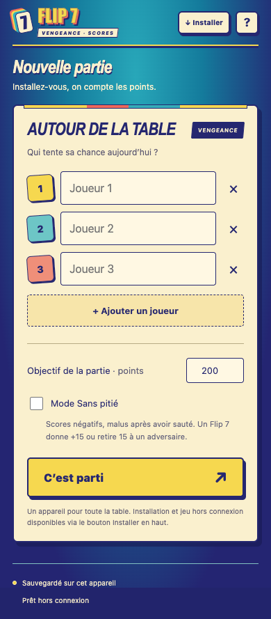

# Flip 7 · Le compteur

Un compteur de points pour **Flip 7 Vengeance**, conçu pour un téléphone ou une tablette posé au milieu de la table. Touchez un joueur, sélectionnez ses cartes et laissez l’application calculer les points.

**[Ouvrir l’application](https://cdesaintleger.github.io/flip7-compteur/)** · **[Télécharger une version](https://github.com/cdesaintleger/flip7-compteur/releases)**



## Fonctionnalités

- De 1 à 18 joueurs, objectif configurable : **200 points** par défaut.
- Saisie tactile des cartes finales, avec les 22 visuels individuels complets.
- Calcul immédiat des numéros, malus, carte ÷2 et bonus Flip 7.
- Un joueur sans carte sélectionnée marque **0**, sans validation individuelle.
- Classement, égalités, vainqueur et revanche avec les mêmes joueurs.
- Historique des cartes, correction d’une manche et annulation de la dernière manche.
- Sauvegarde automatique sur l’appareil.
- Application installable sur l’écran d’accueil et utilisable **hors connexion**.

## Jouer

1. Renseignez les joueurs, choisissez l’objectif et éventuellement le mode **Sans pitié**.
2. À la fin d’une manche, touchez chaque joueur ayant des points et sélectionnez les cartes encore devant lui. Retouchez une carte pour la retirer.
3. Laissez les joueurs sans point à zéro, puis touchez **Terminer la manche**.
4. Pour corriger, utilisez **Modifier** dans l’historique. Les cartes de la manche sont restaurées ; vous pouvez enregistrer ou annuler la correction.

Les effets des cartes Action (vol, échange, défausse…) sont résolus avec le jeu physique avant la saisie. L’application compte les cartes finales ; elle ne simule pas la distribution.

### Calcul des points

Le calcul suit le **livret français, page 6** :

1. Additionner les cartes Numéro.
2. Retirer les malus, avec un minimum de zéro en mode normal.
3. Appliquer la carte **÷2**, en arrondissant à l’inférieur.
4. Ajouter **15 points** si le joueur a sept cartes Numéro.

Le zéro impose zéro point tant qu’il n’y a pas de Flip 7. Le **13 porte-bonheur** autorise un second 13 : les deux rapportent 26 points et comptent comme deux cartes pour le Flip 7. Le **7 porte-malheur** se sélectionne à la place du 7 ordinaire.

> Certaines éditions anglaises appliquent ÷2 avant les autres malus. Cette application retient l’ordre du livret français.

### Mode Sans pitié

Cochez l’option **avant de commencer la partie** :

- Le score d’une manche peut être négatif.
- Un joueur ayant sauté peut encore recevoir des malus : activez **Sauté**, puis sélectionnez ses malus.
- À sept cartes Numéro, choisissez **gagner 15 points** ou **retirer 15 points à un adversaire**. La déduction est appliquée automatiquement au score de la manche de l’adversaire.

## Installer sur un téléphone ou une tablette

- **Android / Chrome** : utilisez le bouton **Installer** ou le menu du navigateur → **Installer l’application**.
- **iPhone / iPad / Safari** : **Partager** → **Sur l’écran d’accueil** → **Ajouter**.
- Ouvrez une première fois avec Internet et attendez **Prêt hors connexion**. Vous pouvez ensuite jouer en mode avion.

Pour récupérer une mise à jour, ouvrez l’application avec Internet, attendez quelques secondes, puis fermez-la et rouvrez-la.

### Où sont enregistrées les parties ?

Les données restent dans le stockage local de ce navigateur, sur cet appareil. Il n’y a ni compte applicatif ni synchronisation entre appareils. Effacer les données du site efface sa sauvegarde.

**Les sauvegardes de l’ancienne adresse Sites ne sont pas transférées vers GitHub Pages**, car chaque adresse possède son propre stockage. Selon le navigateur, l’application installée peut également disposer d’un stockage distinct.

## Développement

L’application est statique : HTML, CSS et JavaScript natif, sans dépendance de production ni étape de compilation.

```sh
git clone https://github.com/cdesaintleger/flip7-compteur.git
cd flip7-compteur
python3 -m http.server 4175 --directory dist
```

Ouvrez ensuite [http://localhost:4175](http://localhost:4175). Un serveur local est nécessaire pour les modules JavaScript et le service worker.

Vérifications avec Node.js 22 ou supérieur :

```sh
npm test
```

Aucune installation de paquets n’est nécessaire. Les vérifications couvrent les règles de score, les cas particuliers et la présence des ressources nécessaires hors connexion.

```text
dist/                    Application prête à héberger
  app.js                 Interface, parties et sauvegarde
  scoring.mjs            Calcul des scores
  assets/cards/          22 cartes complètes
  manifest.webmanifest   Installation sur l’écran d’accueil
  sw.js                  Précache et fonctionnement hors connexion
tests/                   Vérifications sans dépendances
docs/                    Aperçu de l’application
.github/workflows/       Vérifications et déploiement GitHub Pages
```

Le dossier `.openai/` conserve la configuration de l’hébergement Sites d’origine. Il n’est pas utilisé par GitHub Pages.

## Déploiement

Le workflow GitHub Actions vérifie le projet puis publie le dossier **dist/** sur GitHub Pages à chaque push sur **main**. Les pull requests exécutent les vérifications sans déployer.

Dans les paramètres du dépôt, **Pages → Source** doit être réglé sur **GitHub Actions**. Le déploiement peut aussi être relancé depuis l’onglet **Actions**.

Pour une nouvelle version de l’application, incrémentez le nom du cache dans `dist/sw.js` afin que le service worker installe les nouveaux fichiers ensemble. Mettez aussi à jour `package.json` et `CHANGELOG.md` avant de créer un tag de release.

## Crédits

Compteur indépendant, sans affiliation avec les éditeurs du jeu. Flip 7, ses illustrations et ses visuels appartiennent à leurs ayants droit.

Les cartes sont rendues individuellement à partir des groupes vectoriels du [livret officiel français de Flip 7 Vengeance](https://flip-7.com/wp-content/uploads/2026/10/flip7_vengeance_regles_fr.pdf), puis intégrées localement pour le mode hors connexion. Consultez les [règles et informations officielles](https://flip-7.com/flip7-vengeance/).
