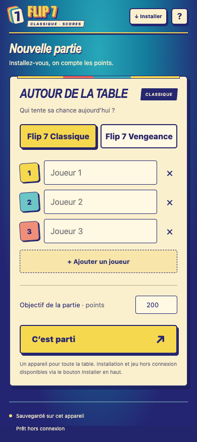
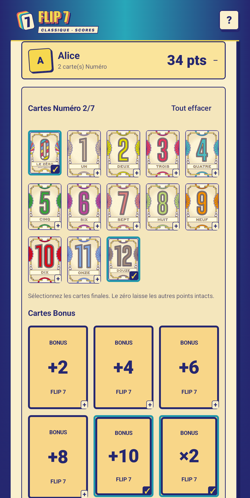

# Flip 7 · Le compteur

Un compteur de points pour **Flip 7 Classique et Flip 7 Vengeance**, à utiliser sur téléphone ou tablette autour du jeu physique. Choisissez l’édition, touchez un joueur et sélectionnez ses cartes : les points et le bonus Flip 7 se calculent immédiatement.

**[Ouvrir la webapp](https://cdesaintleger.github.io/flip7-compteur/)** · **[Télécharger l’APK Android 0.2.0](https://github.com/cdesaintleger/flip7-compteur/releases/download/v0.2.0-android/flip7-compteur-android-0.2.0-debug.apk)** · **[Notes de version et captures](https://github.com/cdesaintleger/flip7-compteur/releases/tag/v0.2.0-android)**

 

## Fonctionnalités

- Deux éditions : **Classique / Vengeance**, avec leurs cartes et leurs règles de calcul.
- De 1 à 18 joueurs ; objectif configurable, **200 points** par défaut.
- Sélection tactile des cartes finales et score en direct.
- Aucune carte sélectionnée = **0 point**, sans validation individuelle.
- Classement, égalités, victoire et revanche avec les mêmes joueurs.
- Historique des cartes, correction d’une manche et annulation de la dernière manche.
- Mode **Sans pitié**, réservé à Vengeance.
- Sauvegarde automatique sur l’appareil et utilisation **hors connexion**.
- Webapp installable sur Android, iPhone et iPad ; application Android native Kotlin / Jetpack Compose.

## Jouer et changer d’édition

1. Choisissez **Flip 7 Classique** ou **Flip 7 Vengeance**, renseignez les joueurs et l’objectif. En Vengeance, vous pouvez activer **Sans pitié**.
2. En fin de manche, touchez les joueurs ayant des points et sélectionnez leurs cartes finales. Retouchez une carte pour la retirer. Activez **Sauté** si nécessaire.
3. Laissez les autres joueurs à zéro, puis touchez **Terminer la manche**.
4. Pour corriger une saisie, utilisez **Modifier** dans l’historique. Vous pouvez enregistrer ou annuler la correction.

Pour changer d’édition pendant une partie, utilisez **Nouvelle partie**, confirmez le remplacement de la partie actuelle, puis choisissez l’autre édition. L’application conserve une seule partie à la fois. L’édition reste associée à la sauvegarde et aux corrections ; les anciennes sauvegardes sont interprétées comme des parties Vengeance.

Résolvez les cartes Action avec le jeu physique avant la saisie. L’application compte les cartes encore devant chaque joueur ; elle ne simule pas la distribution ni les effets des actions.

## Calcul des points

### Flip 7 Classique

1. Additionnez les cartes Numéro, de **0 à 12**.
2. Avec **×2**, doublez uniquement cette somme.
3. Ajoutez les cartes Bonus **+2, +4, +6, +8 et +10**.
4. Ajoutez **15 points** pour sept cartes Numéro.

Le zéro compte comme une carte Numéro et ne supprime pas les autres points. Un joueur ayant sauté marque zéro, bonus compris. Les cartes Bonus seules rapportent des points, même sans Numéro.

Exemple : **7 + 11 + ×2 + bonus 8 = 44 points**. Le ×2 ne double ni les cartes Bonus ni les 15 points du Flip 7. [FAQ de l’éditeur](https://catchupgames.com/flip-7-faq/).

### Flip 7 Vengeance

Le calcul suit l’ordre choisi dans le **livret français, page 6** :

1. Additionnez les cartes Numéro.
2. Retirez les malus, avec un minimum de zéro en mode normal.
3. Appliquez **÷2**, en arrondissant à l’inférieur.
4. Ajoutez **15 points** pour sept cartes Numéro.

Le zéro impose zéro point sans Flip 7 en mode normal. Le **13 porte-bonheur** autorise un second 13 : les deux rapportent 26 points et comptent comme deux cartes. Le **7 porte-malheur** se sélectionne à la place du 7 ordinaire ; saisissez la main finale après avoir résolu son effet.

> La page 9 du livret français et certaines règles anglaises décrivent un autre ordre pour ÷2. L’application applique la page 6 : **malus avant division**.

### Sans pitié — Vengeance uniquement

Activez l’option avant de commencer :

- Les scores de manche peuvent être négatifs.
- Les malus d’un joueur ayant sauté restent comptés : activez **Sauté**, puis sélectionnez ses malus.
- Pour un Flip 7, choisissez **gagner 15 points** ou **retirer 15 points à un adversaire**. La déduction est appliquée au score de manche de cet adversaire.

## Installer

### Webapp — Android, iPhone et iPad

- **Android / Chrome** : bouton **Installer** ou menu du navigateur → **Installer l’application**.
- **iPhone / iPad / Safari** : **Partager** → **Sur l’écran d’accueil** → **Ajouter**.
- Ouvrez une première fois avec Internet et attendez **Prêt hors connexion** avant de passer en mode avion.

Pour récupérer une mise à jour, ouvrez l’application avec Internet, attendez quelques secondes, puis fermez-la et rouvrez-la.

### Application Android native — 0.2.0

Téléchargez l’APK depuis la [release Android 0.2.0](https://github.com/cdesaintleger/flip7-compteur/releases/tag/v0.2.0-android), puis ouvrez-le sur un appareil **Android 8 ou ultérieur**. Si Android le demande, autorisez l’installation depuis le navigateur ou le gestionnaire de fichiers utilisé. Les ressources sont embarquées : le mode hors connexion fonctionne dès l’installation.

**Cet APK est une version de test. Sa signature diffère de celle de la version 0.1.1 : il faut désinstaller l’ancienne application avant de l’installer. La désinstallation efface la partie locale ; terminez-la ou notez ses scores au préalable.**

L’application n’est pas publiée sur le Google Play Store. Voir le [guide Android](android/README.md) pour compiler le projet et préparer une future publication.

## Sauvegardes

Les données restent sur cet appareil, sans compte ni synchronisation : stockage du navigateur pour la webapp, **DataStore** pour Android. La sauvegarde Android dans le cloud est désactivée.

La webapp et l’application Android ont des sauvegardes distinctes, sans transfert automatique. L’ancienne adresse Sites et GitHub Pages ont également des stockages séparés. Selon le navigateur, la webapp installée peut disposer d’un stockage distinct de celui du site ouvert dans un onglet.

Effacer les données du site ou désinstaller l’application native efface la sauvegarde correspondante.

## Développement et tests

### Web

HTML, CSS et JavaScript natif, sans dépendance de production ni compilation :

```sh
git clone https://github.com/cdesaintleger/flip7-compteur.git
cd flip7-compteur
python3 -m http.server 4175 --directory dist
```

Ouvrez [http://localhost:4175](http://localhost:4175). Le serveur local permet de charger les modules JavaScript et le service worker.

Avec **Node.js 22 ou supérieur**, sans installation de paquets :

```sh
npm test
```

Les tests couvrent les deux moteurs de score et les ressources hors connexion. Les parcours navigateur ont également été vérifiés sur petit téléphone, téléphone et tablette, avec correction et réouverture hors connexion.

### Android

Avec **JDK 17** et le SDK Android **36** :

```sh
cd android
./gradlew testDebugUnitTest lintDebug assembleDebug
```

Les 10 tests unitaires incluent les règles classiques, les sauvegardes, les corrections et 96 cas de référence issus du moteur web. Le parcours instrumenté sur émulateur API 35 vérifie Vengeance, Sans pitié, Classique, les corrections et la recréation de l’activité. Voir [android/README.md](android/README.md).

```text
dist/                    Webapp prête à héberger
  app.js                 Interface, parties et sauvegarde
  scoring.mjs            Calculs Classique et Vengeance
  assets/cards/          22 illustrations embarquées de Vengeance
  manifest.webmanifest   Installation sur l’écran d’accueil
  sw.js                  Précache hors connexion
android/                 Application native Kotlin / Jetpack Compose
tests/                   Tests web sans dépendances
docs/                    Captures de l’application
.github/workflows/       Tests, compilation Android et GitHub Pages
```

## Déploiement

Le workflow **Vérifier et publier sur GitHub Pages** teste puis publie `dist/` à chaque push sur `main`. Les PR exécutent les vérifications sans publier. Dans les paramètres du dépôt, **Pages → Source** utilise **GitHub Actions** ; l’environnement de publication autorise `main`.

Le workflow **Android natif** compile l’APK de test et le bundle de préparation non signé, puis exécute les tests sur émulateur. Les artefacts des builds sont disponibles dans **Actions** ; les versions distribuées sont dans **Releases**. Les signatures de débogage peuvent changer entre builds : une mise à jour sans désinstallation nécessite la même clé de signature.

Pour mettre à jour la webapp, changez le nom du cache dans `dist/sw.js` afin que les nouveaux fichiers soient installés ensemble. Avant une release, mettez à jour les versions concernées et `CHANGELOG.md`.

Le dossier `.openai/` conserve la configuration Sites d’origine ; GitHub Pages ne l’utilise pas.

## Crédits

Compteur indépendant, sans affiliation avec les éditeurs du jeu. Flip 7, ses illustrations et ses visuels appartiennent à leurs ayants droit.

Les 22 illustrations embarquées proviennent des groupes vectoriels du [livret français de Flip 7 Vengeance](https://flip-7.com/wp-content/uploads/2026/10/flip7_vengeance_regles_fr.pdf). Les numéros correspondants sont également utilisés dans le mode Classique ; ses cartes Bonus sont dessinées par l’interface. [Informations officielles Vengeance](https://flip-7.com/flip7-vengeance/).
